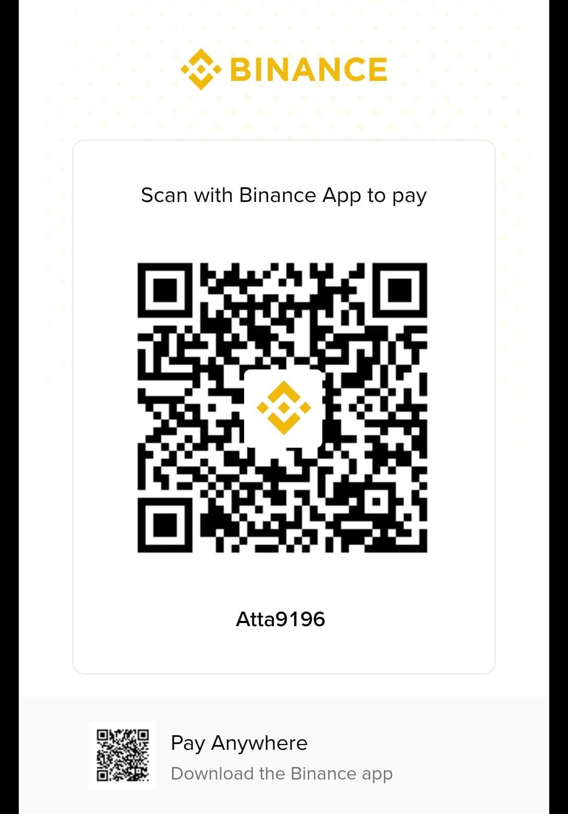

# ❤️ Sponsor & Support My Work

If Turnitout, my research, or my tools have saved you time, protected your intellectual property, or helped your academic workflow, consider supporting ongoing development and high-availability server infrastructure!

Because GitHub Sponsors and Stripe do not currently support accounts in Pakistan, you can support my work globally in under 60 seconds using any of the direct methods below.

---

## ⚡ 1. Instant Crypto / Binance Pay (Global — 0% Fees)

The fastest and easiest way for researchers, engineers, and users worldwide to send support with zero international transaction fees:

* **Binance Pay ID:** `Atta9196`
* **Account Name:** `Ahmad Hassan`

<b>📲 Click to scan / view Binance Pay QR Code</b>

 

  

---

## 🌍 2. International Card / Bank Transfer (USD, EUR, GBP, AUD, CAD, etc.)

> 💡 **Top Recommendation:** Please use **[Remitly](https://www.remitly.com/)** (or **[Wise](https://wise.com/)**) so your card won't get cut off, declined, or cause any frustration! Remitly has seamless 1-minute delivery with debit/credit cards, Apple Pay, and Google Pay straight to Pakistan accounts.

Simply select **Pakistan (PKR) → Bank Deposit** on **Remitly** or **Wise** (or International Wire in your banking application) and enter these details:

| Field | Details (Click to Copy) |
| :--- | :--- |
| **Account Holder Name** | `Ahmad Hassan` |
| **IBAN** | `PK07UNIL0109000387828585` |
| **SWIFT / BIC Code** | `UNILPKKA` |
| **Bank Name** | `United Bank Limited (UBL Ameen)` |
| **Account Number** | `2523387828585` |
| **Branch Code** | `2523` |
| **Country** | `Pakistan` |

---

## 🇵🇰 3. Local Transfers (Pakistan — Raast / IBFT)

For supporters inside Pakistan, you can transfer directly via Raast (instant 0-fee) or standard IBFT to either account:

### **SadaPay (Raast / Wallet / IBFT)**
* **Account Title:** `Ahmad Hassan`
* **Raast ID / Mobile:** `03225522383` (`+92 3225522383`)
* **IBAN:** `PK44SADA0000003225522383`

### **UBL Ameen (IBFT)**
* **Account Title:** `Ahmad Hassan`
* **Account Number:** `2523387828585` (Branch Code: `2523`)
* **IBAN:** `PK07UNIL0109000387828585`

---

## 💬 Prefer Another Alternative? I'm Always Available! :D

If you prefer any other alternative method (PayPal, Payoneer, USDT via TRC20/BEP20, Western Union, etc.), don't hesitate to reach out! I am readily available and happy to coordinate whatever method is most convenient for you:

* 📱 **WhatsApp / Direct Mobile:** **[+92 322 5522383](https://wa.me/923225522383)** (`03225522383`)
* ✉️ **Email:** [ahmadhassan.bted@gmail.com](mailto:ahmadhassan.bted@gmail.com)

*After sending, feel free to drop a quick message on WhatsApp so I can personally acknowledge your support and say thank you! 🙏*
